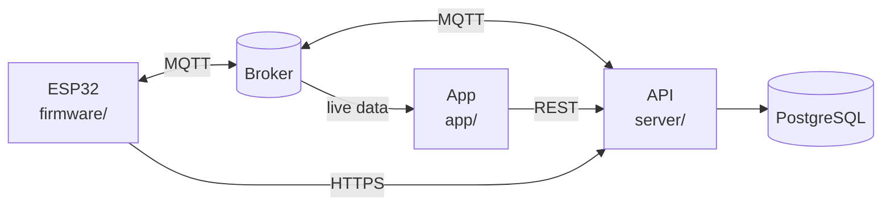
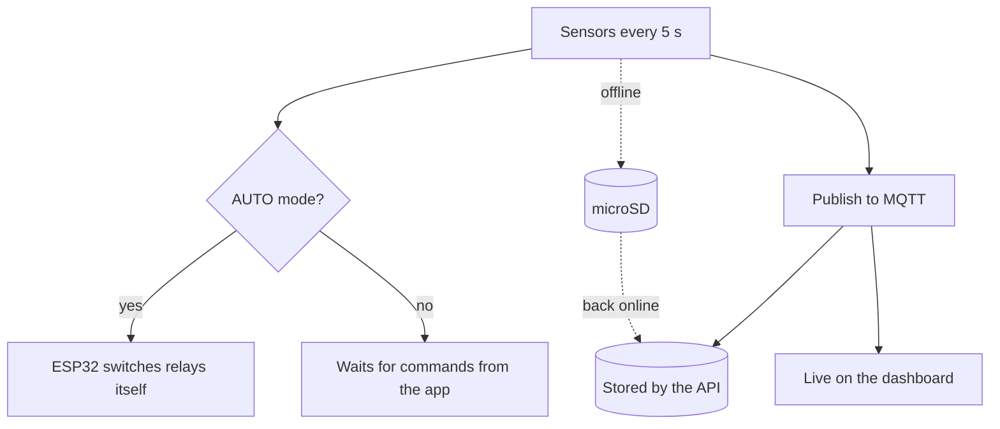
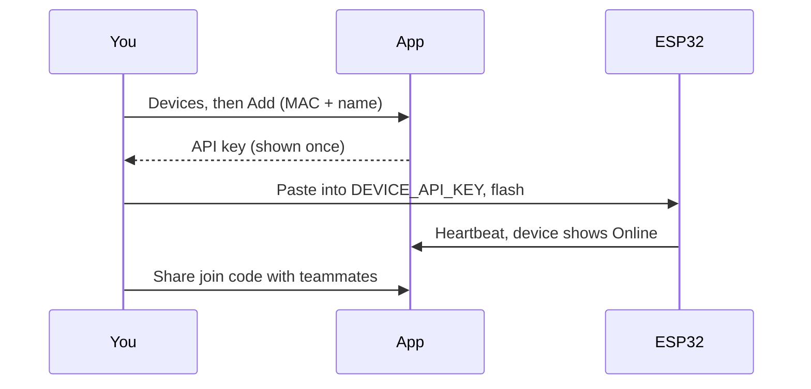

# BSFLY IoT

IoT environmental control for Black Soldier Fly larvae farming. An ESP32 reads the sensors in each drawer and switches the fans, heater, humidifiers and light. You watch and control it from your phone.



## What's inside

| Folder | What | Stack |
|---|---|---|
| [`firmware/`](firmware/README.md) | Sensors, relays, LCDs, SD buffer, OTA | ESP32, PlatformIO, `lib/bsfly` |
| [`server/`](docs/architecture.md) | REST API, MQTT bridge, reports | Node 20+, Express 5, Drizzle, Postgres |
| `app/` | Dashboard, controls, analytics, backup | Ionic 8, React 19, Capacitor (Android) |
| [`docs/`](docs) | Architecture, database, deployment | Mermaid diagrams |

## How it works



## Quick start (local)

### 1. Server
```bash
cd server
cp .env.example .env        # fill in Clerk + MQTT
docker compose up -d        # local Postgres
npm install
npm run db:migrate
npm run dev                 # http://localhost:5000
```

### 2. App
```bash
cd app
cp .env.example .env        # VITE_BACKEND_URL=http://localhost:5000
npm install
npm run dev                 # http://localhost:5173
npm run dev:demo            # fake data, no login needed
```

### 3. Firmware
```bash
cd firmware
cp include/credentials.h.example include/credentials.h
pio run -t upload
```
On first boot, connect to the `setupBSF` Wi-Fi hotspot and pick your network.

## Add your device



### How to get ESP32 MAC address

Run `pio device monitor`. Once the device joins Wi-Fi it prints `Device ID: AA:BB:CC:DD:EE:FF`.

You can also open `http://<device-ip>/status` from a browser on the same network and read `deviceId`.

## Docs

- [Architecture](docs/architecture.md): data flow, MQTT topics, who can call what
- [Database](docs/database.md): schema diagram, setup, migrating from MongoDB
- [Deployment](docs/deployment.md): free hosting with Neon, Render, Vercel, EMQX and Clerk
- [Firmware](firmware/README.md): wiring, build, OTA

## Tests

```bash
cd server && npm test        # API tests on in-memory Postgres
cd app && npx vitest run
cd firmware && pio run       # compile check
```

## License

[MIT](LICENSE)
