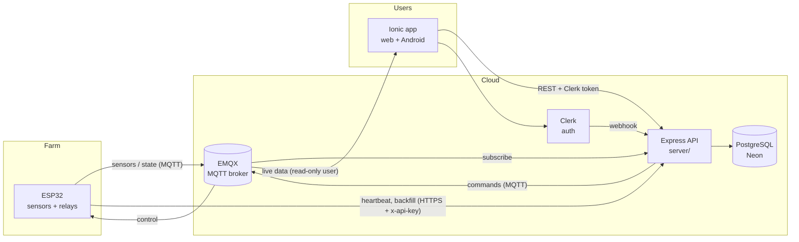
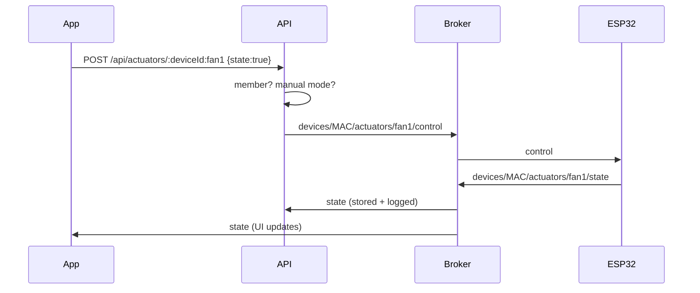

# Architecture

## Big picture



The app never publishes to MQTT. Every command goes through the API, which checks membership and AUTO/MANUAL mode first.

## A command, end to end



## MQTT topics

| Topic | From | Payload |
|---|---|---|
| `devices/<MAC>/sensors` | ESP32 | `{drawerName, temperature, humidity, leftSubstrate, centerSubstrate, rightSubstrate, ammonia}` |
| `devices/<MAC>/actuators/<name>/state` | ESP32 | `{state}` |
| `devices/<MAC>/actuators/<name>/control` | API | `{state}` |
| `devices/<MAC>/actuators/mode/control` | API | `{state: "auto" \| "manual"}` (retained) |

## Who can call what

| Caller | Auth | Endpoints |
|---|---|---|
| App user | Clerk Bearer token | everything under `/api` except device-only routes |
| ESP32 | `x-api-key` | `POST /api/devices/<MAC>/heartbeat`, `POST /api/sensors`, `GET /api/actuators/<MAC>:<name>` |
| Clerk | Svix signature | `POST /api/webhooks/clerk` |
| Anyone | none | `GET /api/time`, `GET /health` |

A device is **online** when its last heartbeat or MQTT message is newer than 20 s. No background sweep needed.

## Repo layout

```
firmware/   ESP32 PlatformIO project (lib/bsfly = reusable library)
app/        Ionic + React + Capacitor client
server/     Express API, Drizzle schema, migrations
docs/       you are here
```
