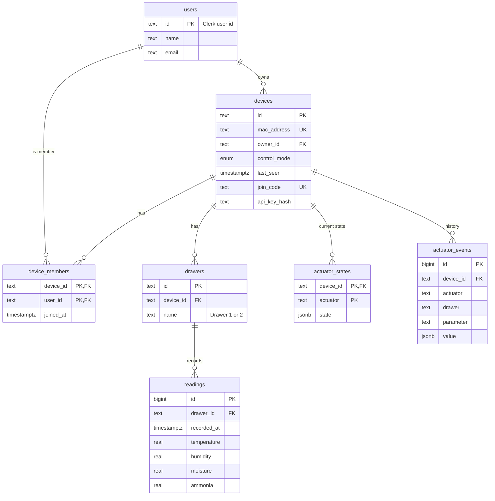
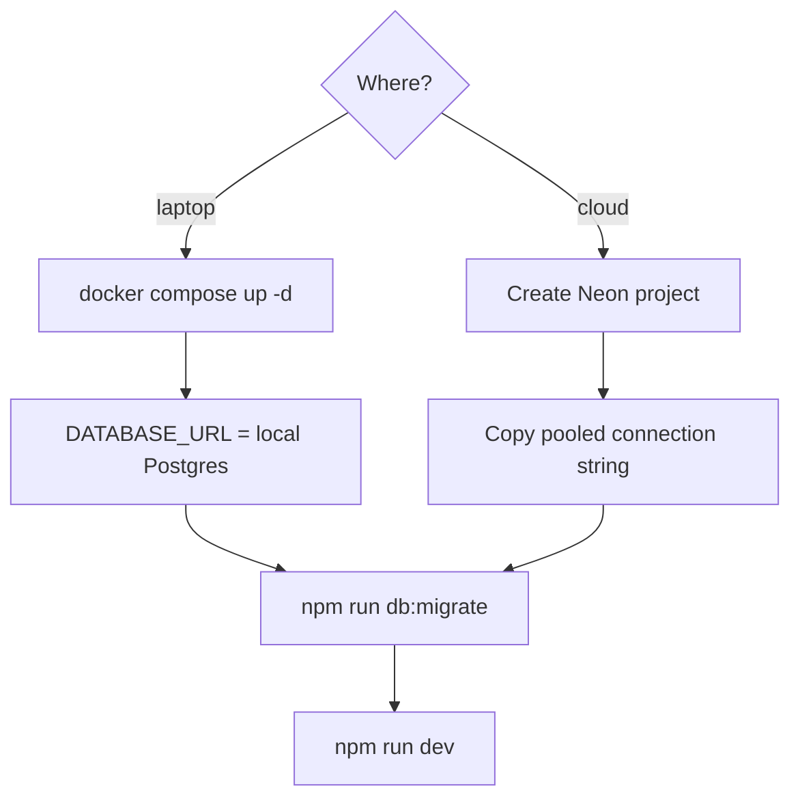

# Database

PostgreSQL, managed with [Drizzle](https://orm.drizzle.team). Schema: `server/src/db/schema.js`. Migrations: `server/drizzle/`.

## Why SQL

Users, devices, members and drawers are relational, and readings are time series. Postgres gives foreign keys, cascading deletes and `GROUP BY hour` for charts, so the server doesn't have to do it by hand.

## Schema



- Deleting a user deletes the devices they own and all of those devices' data.
- API keys are stored as SHA-256 hashes. The full key is shown once, when you register the device or regenerate its key.

## Setup



```bash
cd server
cp .env.example .env
docker compose up -d
npm install
npm run db:migrate
npm run dev
```

Changed the schema? Run `npm run db:generate`, commit the new file in `drizzle/`, then `npm run db:migrate`. You can browse the data with `npm run db:studio`.

## Moving old MongoDB data

```bash
MONGODB_URI="mongodb+srv://…" npm run migrate:mongo
```

The script only reads from Mongo, and it's safe to run twice. Device IDs are kept. Old API keys still hash to the same value, but the firmware never sent one, so **regenerate each device's key in the app and re-flash**.

## Storage budget

At one reading every 5 s per drawer, that's about 35k rows and roughly 4 MB per day. Neon's free 0.5 GB lasts about 4 months. To keep only the last 90 days:

```sql
delete from readings where recorded_at < now() - interval '90 days';
```
