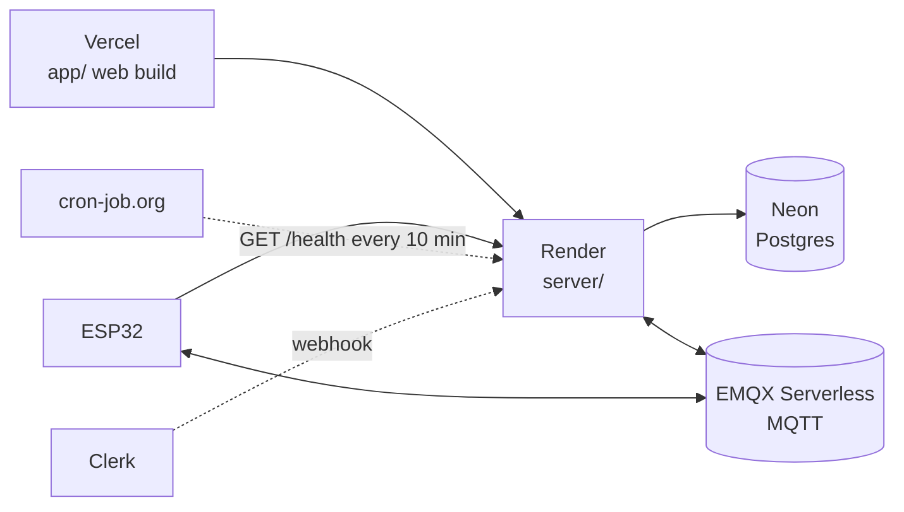

# Deployment (free tiers)



| Piece | Host | Free tier catch |
|---|---|---|
| Database | Neon | 0.5 GB, compute sleeps when idle (wakes in under 1 s) |
| API | Render web service | Sleeps after 15 min with no traffic. Use the ping below. |
| Web app | Vercel Hobby | Non-commercial use only |
| MQTT | EMQX Serverless | Monthly session-minute and traffic quota |
| Auth | Clerk | Free up to a monthly active-user cap |
| Keep-alive | cron-job.org | none |

Free tiers change. Check each provider's pricing page before relying on these limits.

## 1. Database: Neon
1. Create a project, then copy the pooled connection string.
2. Run `DATABASE_URL=… npm run db:migrate` from `server/`.

## 2. MQTT: EMQX Serverless
Create two users, then set their rules under Access Control > Authorization:

| User | Used by | Allow |
|---|---|---|
| `bsfly-server` | API + ESP32 | publish + subscribe `devices/#` |
| `bsfly-web` | browser | subscribe only: `devices/+/sensors`, `devices/+/actuators/#` |

The browser user ships in the public JS bundle, which is why it can't publish. Download the broker's CA certificate and paste it into `MQTT_ROOT_CA` in the firmware.

## 3. API: Render
1. Create a New Web Service with the root directory set to `server`.
2. Build command: `npm ci`. Start command: `npm run db:migrate && npm start`.
3. Environment: copy every variable from `server/.env.example`. Keep `TZ=Asia/Manila` so the 19:00 light schedule runs on local time.
4. On cron-job.org, set `https://<service>.onrender.com/health` to run every 10 min.

That uses about 744 of Render's 750 free hours a month, so run only one free service.

If you want an API that never sleeps, use an Oracle Cloud Always Free Ampere VM instead. Install Node 20+, clone the repo, run `npm ci && npm run db:migrate`, and keep `npm start` running with systemd or `pm2`. Put Caddy in front of it for HTTPS.

## 4. Web app: Vercel
1. Import the repo and set the root directory to `app`. The framework is Vite.
2. Environment: set the variables from `app/.env.example`, with `VITE_BACKEND_URL` pointing at Render.
3. Add the Vercel URL to `ALLOWED_ORIGINS` on Render.

## 5. Clerk
1. Copy the publishable key to the app, and the secret key to the server.
2. In Webhooks, add the endpoint `https://<api>/api/webhooks/clerk` with the events `user.created`, `user.updated` and `user.deleted`. Put its signing secret in `CLERK_WEBHOOK_SECRET`.

## 6. Android
```bash
cd app && npm run build && npx cap sync android && npx cap open android
```
