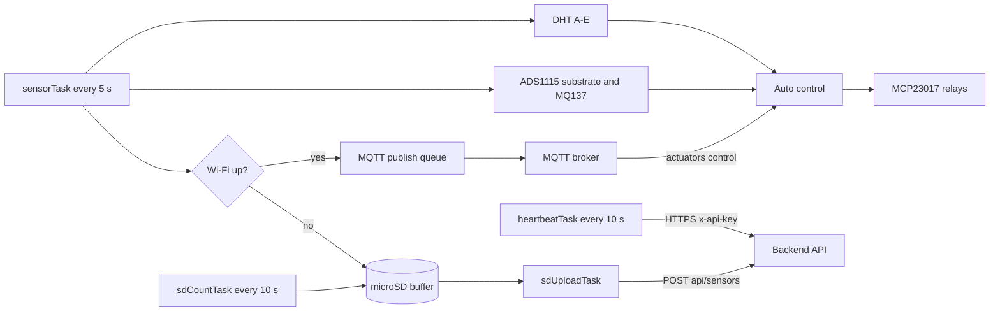

# BSFLY ESP32 firmware

PlatformIO project for the BSFLY black soldier fly incubator controller (ESP32 DevKit, Arduino framework).

## Wiring

| Signal | GPIO | Used by |
|---|---|---|
| I2C SDA | 21 | ADS1115 x2, MCP23017, TCA9548A, LCDs |
| I2C SCL | 22 | same I2C bus |
| SPI SCK | 18 | microSD |
| SPI MISO | 19 | microSD |
| SPI MOSI | 23 | microSD |
| SD CS | 15 | microSD |
| LED | 4 | LED_PIN |
| DHT A (drawer 1) | 16 | DHT11/DHT22 auto-detect |
| DHT B (drawer 1) | 26 | DHT11/DHT22 auto-detect |
| DHT C (drawer 1) | 25 | DHT11/DHT22 auto-detect |
| DHT D (drawer 2) | 14 | DHT11/DHT22 auto-detect |
| DHT E (drawer 2) | 27 | DHT11/DHT22 auto-detect |

I2C addresses: ADS1115 0x48 (substrate) and 0x49 (MQ137), MCP23017 0x20 (actuators, active low), TCA9548A 0x70, LCD 0x27 behind TCA channels 0 and 1.

## Build and upload

```sh
cp include/credentials.h.example include/credentials.h
# fill in backend, MQTT, CA PEMs, API key and passwords
pio run
pio run -t upload
pio device monitor
```

## Local web portal

- `/hardware`, `/status`, `/sdcard/data`, `/sdcard/sync`: no login
- `http://<device-ip>/update`: ElegantOTA firmware upload, basic auth with OTA_USERNAME / OTA_PASSWORD
- `/reboot`, `/sdcard/clear`, `/calibrate/*`: basic auth with DEVICE_ADMIN_USER / DEVICE_ADMIN_PASSWORD

## Task and data flow


